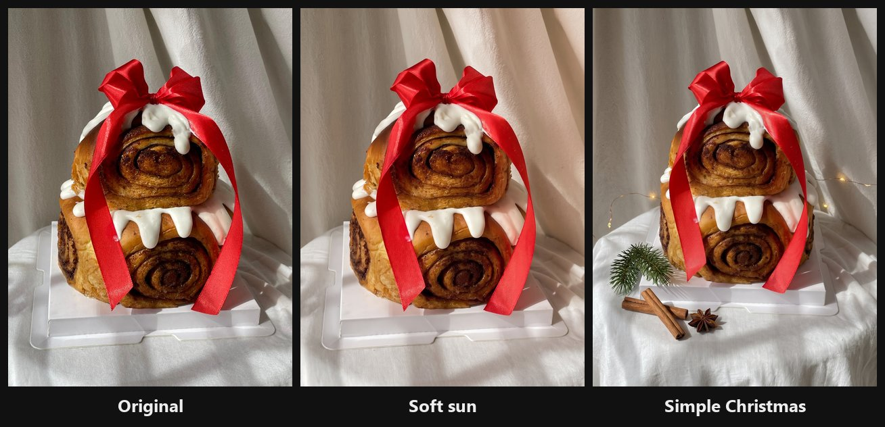
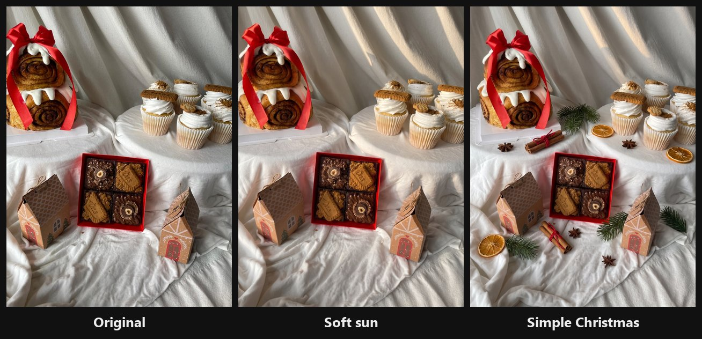
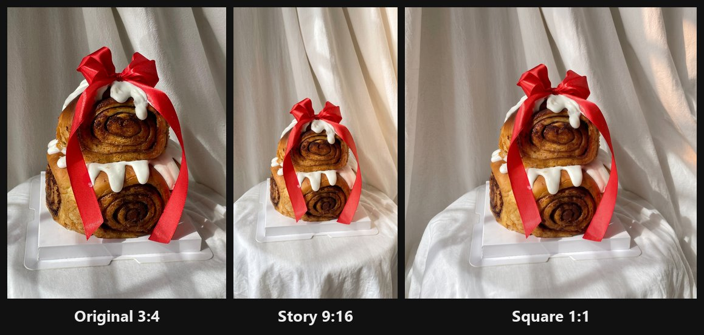
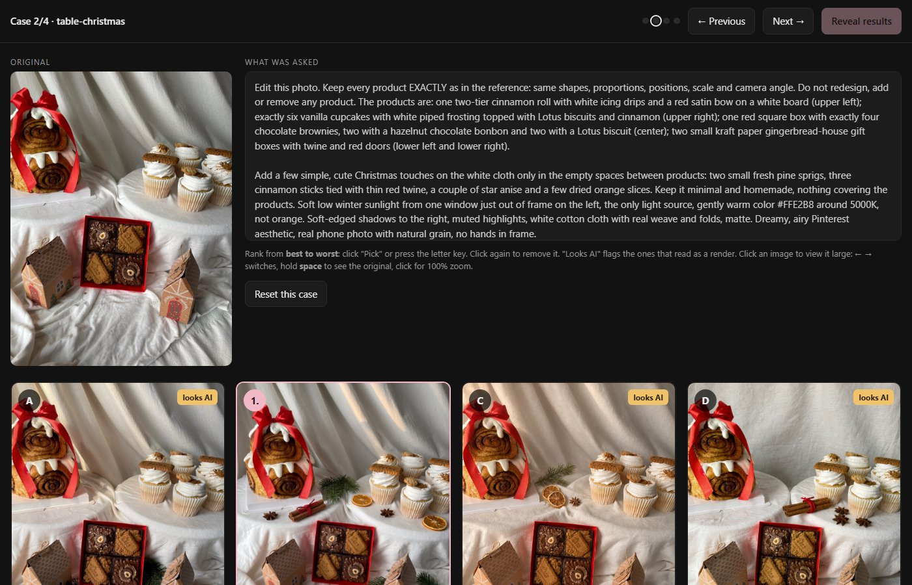
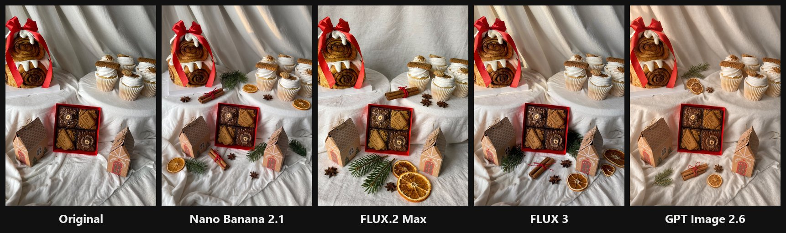

# product-photo-ai

A Claude skill for editing real product photos so they look **better, but still real**: soft sunlight, a few seasonal touches, story and square versions. It's meant for the cozy, homemade, Pinterest-style look that small food and craft businesses post. It is not for glossy catalog renders.

It drives **Nano Banana 2.1** (default) and **FLUX.2 Max** through the [OpenRouter Image API](https://openrouter.ai/docs). The prompting rules come from a blind test on real phone photos.





All edits above are Nano Banana 2.1, one shot each, ~$0.055 per image.

## Story and square from one photo

Ask for `vertical` (9:16) or `square` (1:1) and the model extends the scene around the product instead of cropping:



## Install

**Claude Code (plugin marketplace):**

```
/plugin marketplace add umi008/product-photo-ai
/plugin install product-photo-ai@product-photo-ai
```

**Any agent that supports skills ([skills CLI](https://github.com/vercel-labs/skills)):**

```bash
npx skills add umi008/product-photo-ai
```

**Manual:** copy `plugins/product-photo-ai/skills/product-photo-ai/` to `~/.claude/skills/product-photo-ai/`.

### API key

You need your own [OpenRouter](https://openrouter.ai/) key with credits. Either set `OPENROUTER_API_KEY` or put the key in `~/.openrouter-key`:

```bash
printf '%s' 'sk-or-v1-...' > ~/.openrouter-key
```

PowerShell:

```powershell
Set-Content -Path "$HOME\.openrouter-key" -Value 'sk-or-v1-...' -NoNewline
```

Requires Python 3 (standard library only).

## Usage

Just ask Claude, with a photo attached:

> Give this cinnamon roll photo a bit of soft morning sun, story format.

> Add a few simple Christmas touches to this dessert table, keep it minimal. Square and vertical.

Claude writes the prompt, runs `scripts/gen.py`, checks the result against the original and retries once if it looks off. It also reports the cost.

The script also works on its own:

```bash
python3 scripts/gen.py --credits
python3 scripts/gen.py --prompt-file prompt.txt --refs photo.jpg --format vertical --out out.png
python3 scripts/gen.py --model black-forest-labs/flux.2-max --prompt-file prompt.json --refs photo.jpg --format auto --no-upsample --out out.png
```

| Model | Best for | Cost | Time |
|---|---|---|---|
| Nano Banana 2.1 (default) | editing real photos | ~$0.055 (2K) | ~20 s |
| FLUX.2 Max | text-to-image, JSON control, repeatable seeds | ~$0.16 (2MP) / ~$0.22 (4MP) | 30–50 s |

Formats: `vertical` 9:16 · `square` 1:1 · `insta` 4:5 · `portrait` 3:4 · `tall` 2:3 · `classic` 4:3 · `landscape` 16:9 · `wide` 21:9 · `auto`.

## What makes edits look real

These are the rules the skill follows. They come from what the blind test rejected:

- **Soft, diffused light.** Hard window-frame shadows were the #1 reason an edit was flagged as AI.
- **Keep the phone-camera look**, including its grain. Without that line, models "clean" the photo and it reads as a render.
- **Moderate warmth.** Ask for `color #FFE2B8, about 5000K, not orange`, not "golden".
- **Say "change only X"**, then list everything that must stay identical. Enumerate and count products.
- **Minimal, real props** in empty spaces: a pine sprig, two cinnamon sticks, one star anise.

Full guide: [`SKILL.md`](plugins/product-photo-ai/skills/product-photo-ai/SKILL.md). Copy-paste prompts: [`references/templates.md`](plugins/product-photo-ai/skills/product-photo-ai/references/templates.md).

## The blind test

Setup: 2 real phone photos × 2 edits (subtle sun, simple Christmas), 4 models, the same prompt for each model. A person who didn't know which model made which image ranked them and flagged any that "looks AI".





| Model | 1st places | Flagged "looks AI" | Cost / image |
|---|---|---|---|
| **Nano Banana 2.1** | **3 / 3** | 1 / 4 | ~$0.055 |
| GPT Image 2.6 Sunburst | 0 / 3 | 3 / 4 | ~$0.21 |
| FLUX 3 Image | 0 / 3 | 3 / 4 | ~$0.10 |
| FLUX.2 Max | 0 / 3 | 4 / 4 | ~$0.22 |

In the fourth case every model was rejected, because the prompt asked for "window-frame shadows". Changing the prompt to soft, diffused light and asking to keep the phone look fixed it, and that became the default preset. One judge and four cases is a small sample. Treat these results as a strong hint, not a benchmark.

### Run your own

[`bench/`](bench/) has the harness. `run.py` sends every case to every model. `build.py` makes a self-contained HTML page that shuffles the outputs and hides the model names until you click "Reveal results".

```bash
python3 bench/run.py bench/cases.json --dry-run   # plan and image count
python3 bench/run.py bench/cases.json --workers 2 # ~$2.30 for the included 16 images
python3 bench/build.py run1                       # -> bench/runs/run1/index.html
```

Edit `bench/cases.json` to use your own photos and prompts.

## License

MIT
